# PeopleOS

**The intelligent workspace for people operations.** PeopleOS is an HR operations platform: employee records, an HR service desk, leave and approvals, onboarding and offboarding, workflow automation, a company policy library, workforce analytics and a policy-grounded assistant — with permissions enforced at every step.

**Live demo:** https://katrine-daniel.github.io/TalentNest/ — runs the demo workspace (fictional data, stored only in your browser). Pick any of the five roles on the sign-in screen.

> The repository is named `TalentNest` for historical reasons; the product is PeopleOS (v1.0.0). The earlier TalentNest recruitment app remains in Git history.

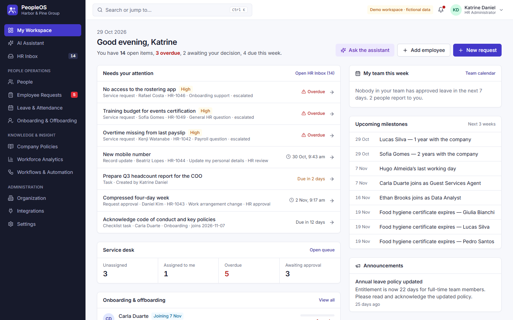

## Contents

- [Features](#features) · [Demo mode and what is not included](#demo-mode-and-limitations) · [Tech stack](#technology) · [Architecture](#architecture)
- [Getting started](#getting-started) · [Configuration](#configuration) · [Database](#database-supabase) · [Testing](#testing) · [Deployment](#deployment) · [Security](#security)

## Features

All features below work in the demo. Items marked † additionally need the Supabase backend for real multi-user use.

| Area                         | What it does                                                                                                                                                                                                                                                                                                                                                                                                                                                       |
| ---------------------------- | ------------------------------------------------------------------------------------------------------------------------------------------------------------------------------------------------------------------------------------------------------------------------------------------------------------------------------------------------------------------------------------------------------------------------------------------------------------------ |
| **My Workspace**             | Role-aware start page: what needs your attention (from real records), service-desk queue counts, active onboarding/offboarding with progress, team leave this week, upcoming joiners/leavers/anniversaries/expiring documents, announcements.                                                                                                                                                                                                                      |
| **HR Inbox**                 | One queue for leave and request approvals, record-update reviews, assigned service requests, checklist tasks, document reviews, tasks and policy acknowledgments. Items are derived live from the underlying records; approving or completing an item changes the record itself. Filter, search, sort, snooze.                                                                                                                                                     |
| **People**                   | Directory with search, filters, sorting, paging and CSV export (work fields only). Profiles with change history, documents, equipment, leave and requests. Validated create/edit with duplicate detection and reporting-loop checks. CSV import with a row-by-row error report. Departure recording and personal-data erasure for former employees. Sensitive fields (personal contact, date of birth, emergency contact) are visible only to HR and the employee. |
| **Employee Requests**        | Service desk with configurable request types, approval chains (manager / department head / HR / named person), delegation, business-hour service targets, escalation of overdue work, comments, HR-only internal notes, attachments, explicit status transitions and resolution notes. Personal-detail update requests apply the change to the record when approved.                                                                                               |
| **Leave & Attendance**       | Leave types with entitlements, carry-over and approval rules; day counts from each person's work schedule and location holidays; balances (entitlement × FTE, pro-rated, plus adjustments, minus approved and pending); overlap and balance checks re-run at approval; cancellation rules; team calendar.                                                                                                                                                          |
| **Onboarding & Offboarding** | Reusable templates matched by department, location and employment type; tasks with owners, due dates, required documents and overdue indicators; progress and activity history. Tasks that change other systems (accounts, access, payroll) must be confirmed by a person — PeopleOS never claims to have done them.                                                                                                                                               |
| **Workflows & Automation**   | Rules with triggers, conditions and actions (create task, notify, request approval, update an employee field, start a checklist, email†). Validation, dry-run preview on a real record, once-per-record execution, retries, execution log and change history.                                                                                                                                                                                                      |
| **Company Policies**         | Draft → review → publish with versions and effective dates; the published version stays in force while a new draft is edited; audience by department; acknowledgments per version with outstanding lists; review dates.                                                                                                                                                                                                                                            |
| **AI Assistant**             | Answers policy questions with the policy, section, version and effective date as sources, and record questions (your approvals, overdue onboarding, open requests, today's follow-ups, your leave balance) from data you can access. Suggestions are labelled as such; links that would start an action ask for confirmation; unanswerable questions get an honest "I couldn't find…".                                                                             |
| **Workforce Analytics**      | Headcount, joiners, leavers and turnover; headcount by department/location; requests by category, open/overdue, median resolution and SLA; approval turnaround; onboarding on-time rate; leave usage (groups under 3 hidden); policy acknowledgment. Every figure has its formula, a table view and CSV export.                                                                                                                                                    |
| **Organization**             | Company profile and terminology, departments, teams, locations, employment types, work schedules, holidays, request types, leave types, lifecycle templates, users and roles (invites †).                                                                                                                                                                                                                                                                          |
| **Also**                     | Ctrl/Cmd+K command palette over records you may see, notifications with preferences, audit log, keyboard navigation and skip link, responsive layouts down to phone width.                                                                                                                                                                                                                                                                                         |

<details>
<summary>More screenshots</summary>

|                                                |                                                        |
| ---------------------------------------------- | ------------------------------------------------------ |
| 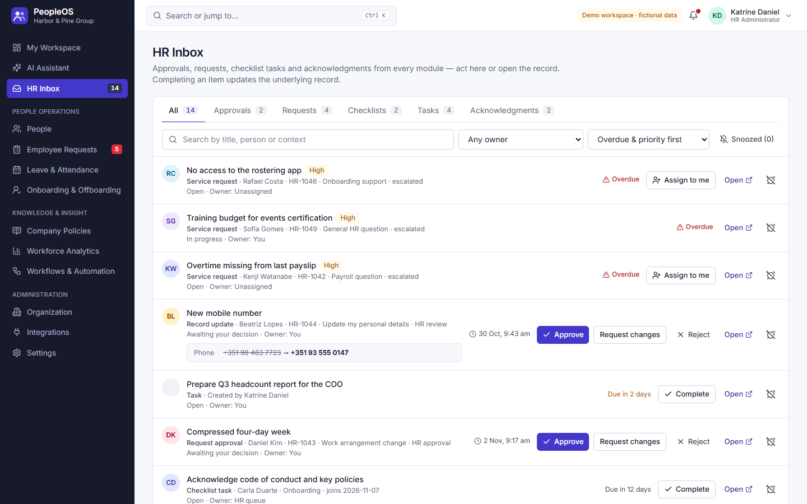        | 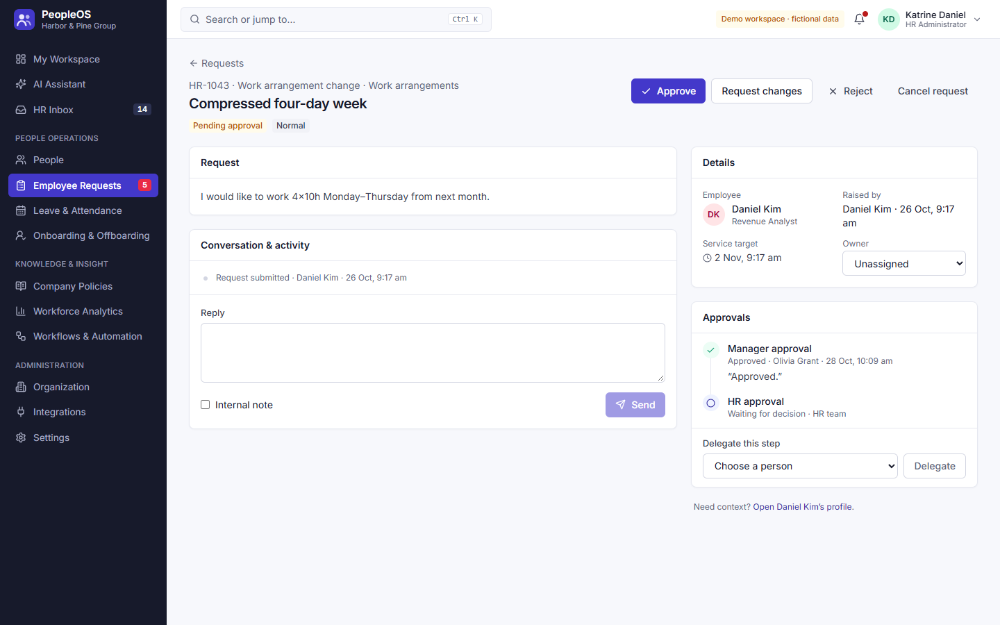        |
| 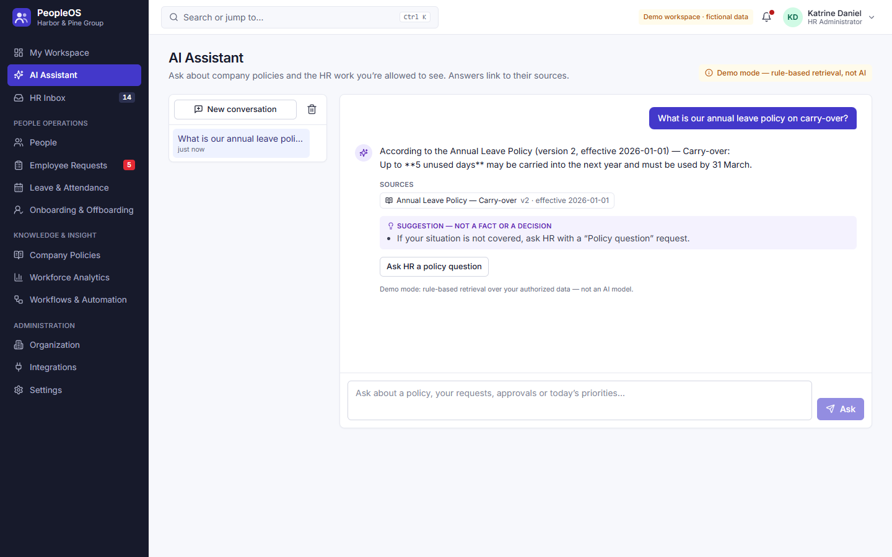   | 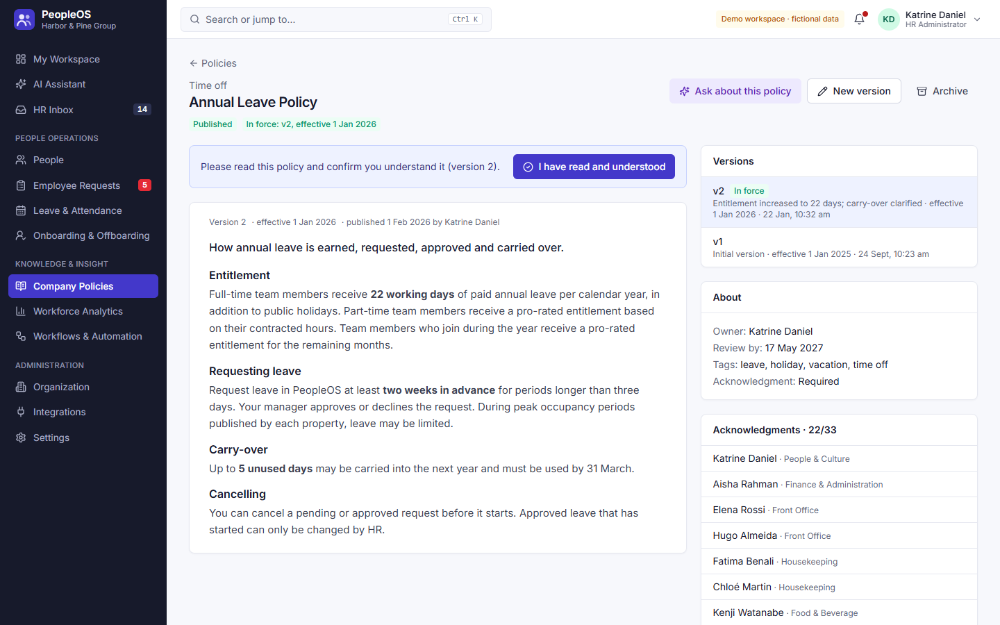                 |
| 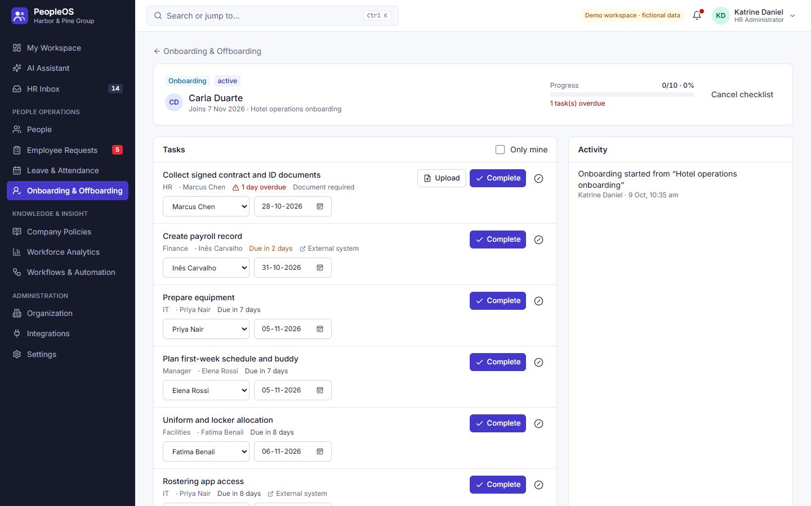 | 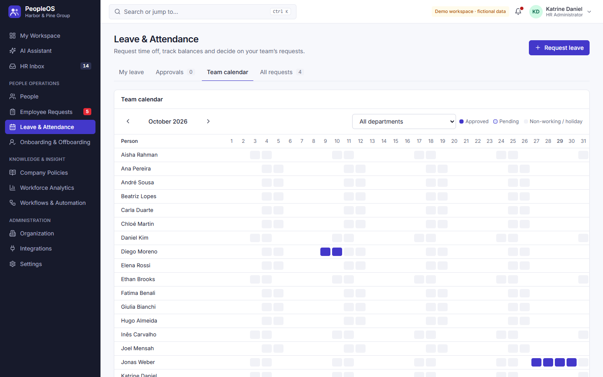 |
| 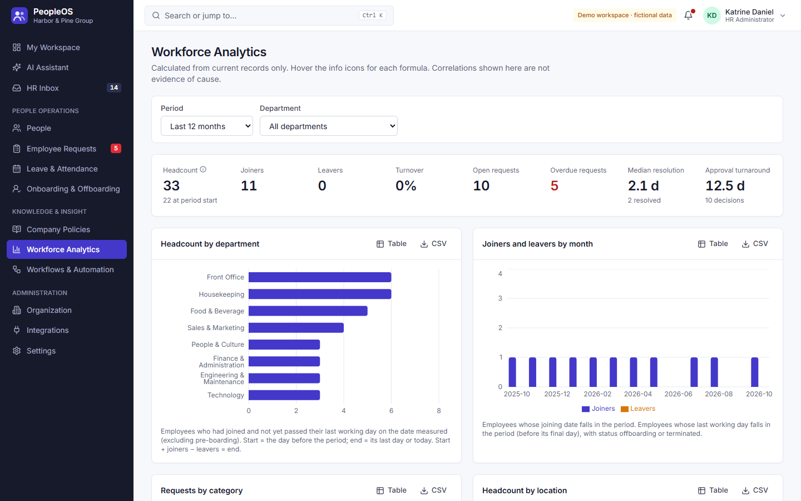   | 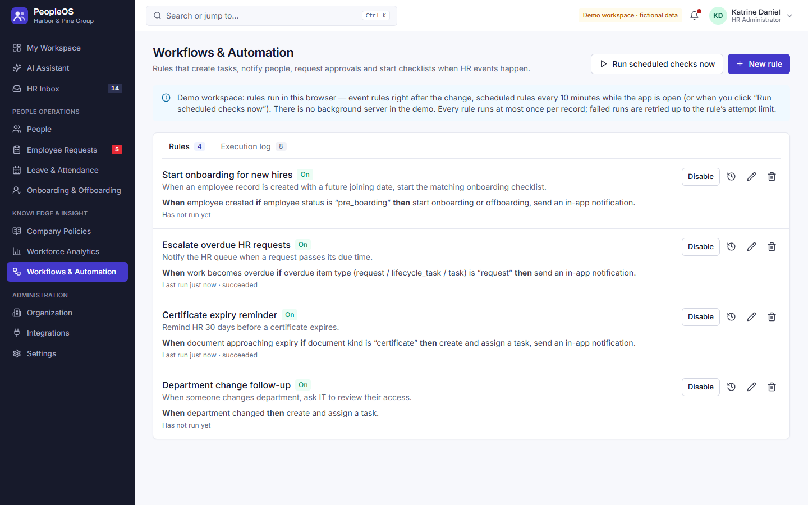         |
| 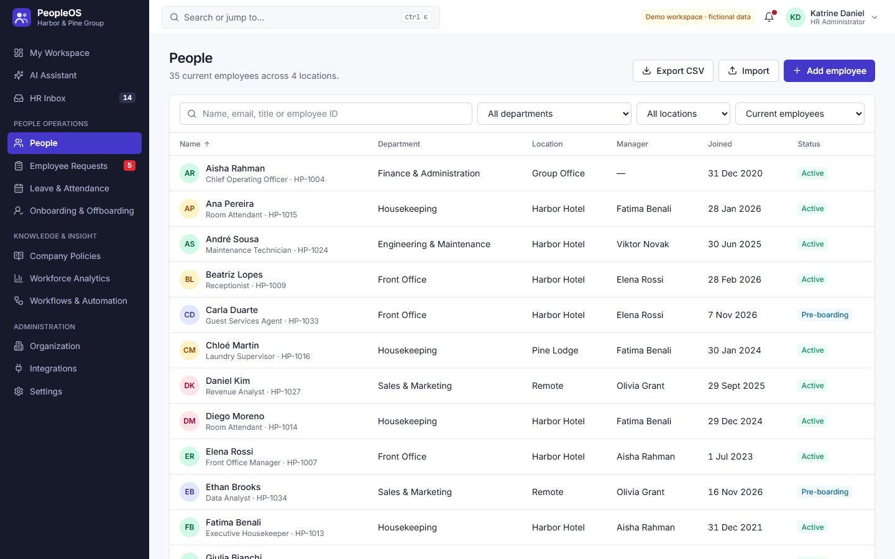         | 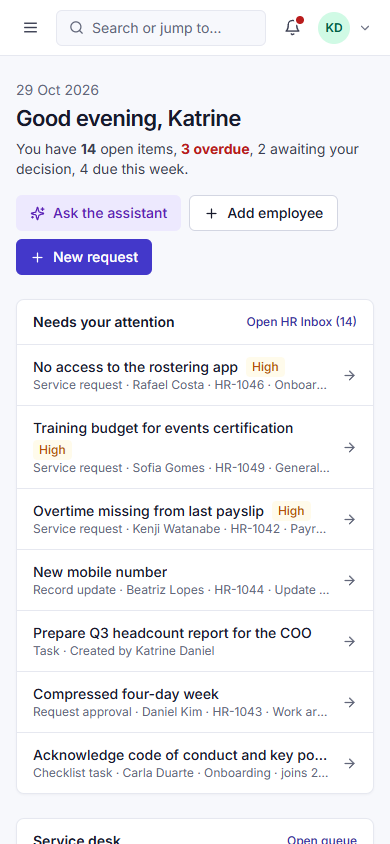       |

</details>

### Roles

| Role                       | Can do                                                                                                                                |
| -------------------------- | ------------------------------------------------------------------------------------------------------------------------------------- |
| Employee                   | Own requests, leave, onboarding tasks, policies and assistant; directory work profiles                                                |
| Manager                    | + approve their reporting line's requests and leave, see the team's employment records and calendar, analytics for their department   |
| HR Specialist              | + all people records incl. sensitive fields, service-desk queue and internal notes, leave balances, onboarding/offboarding, analytics |
| HR Administrator           | + policies, automation, organization configuration, audit log                                                                         |
| Organization Administrator | + user roles, invitations and personal-data erasure                                                                                   |

## Demo mode and limitations

**Demo mode** is what the live site runs: no backend is configured, so PeopleOS loads a fictional hospitality group (35 people, ~13 requests, leave, checklists, 7 policies) into your browser's localStorage. "Reset demo data" in the account menu restores it. Demo sign-in authenticates nobody — it lets you see each role.

- **Assistant (demo):** a deterministic retrieval-and-rules engine, labelled "Demo mode — not AI". It is not a language model. With `VITE_ASSISTANT_URL` set, policy questions go to the `assistant` Edge Function, which calls Claude with only the published policies the user may read; record questions are still computed locally from permission-filtered data.
- **Automation (demo):** runs in the browser — event rules immediately after a change, scheduled checks every 10 minutes while the app is open. There is no background server.

**Known limitations**

- **Supabase backend:** schema, row-level security and triggers are verified on Postgres (41 checks, see [Testing](#testing)), and the client driver is unit-tested — but the full stack (Supabase Auth, PostgREST, Storage, the Edge Functions) **has not been run against a live Supabase project**, because no credentials were available. Treat it as ready to deploy and verify, not as proven in production.
- **No server-side scheduler:** in a Supabase deployment, scheduled checks (joins, leavers, overdue escalation, expiring documents, retries) run in the browser of signed-in HR users. Nothing runs while no HR user has the app open.
- **Automation permissions:** an action that needs a privilege the triggering user lacks (start a checklist, update an employee, raise an approval) is recorded as failed and retried by an HR session's scheduled check.
- **Not integrated:** email delivery, calendars, single sign-on, HRIS/payroll. The Integrations page shows these as not connected; "send email" actions are recorded as skipped.
- **No country-specific rules:** payroll, tax and employment law are not built in. Leave types, holidays and approval rules must be configured for each country you employ people in.
- **SLA clock:** business hours are Mon–Fri 09:00–17:00 local time; holidays are not excluded.
- **Leave day counts** are computed in the browser; the database guards who may change a request and its status, not the arithmetic.
- **Dependency advisories** — see [SECURITY.md](SECURITY.md#known-dependency-advisories).

## Technology

React 18 · TypeScript (strict) · Vite 5 · Tailwind CSS 4 · React Router 6 · Recharts · Lucide icons · Supabase (Postgres, Auth, Storage, Edge Functions) · Vitest + Testing Library · Playwright · PGlite (database tests) · ESLint · Prettier · GitHub Actions + Pages.

## Architecture

```
src/
  domain/       Pure business rules: types, permissions, leave, approvals, SLA, inbox, analytics, automation, assistant
  services/     Use cases that check permissions and change data (employees, requests, leave, lifecycle, policies, automation, …)
                + store (observable data), demoDriver (localStorage), supabaseDriver, supabaseSession, files
  features/     One folder per page/module (workspace, inbox, people, requests, leave, lifecycle, policies, …)
  components/   Design-system primitives (ui/) and the application shell (shell/)
  app/          Routing, session/auth provider, hooks, error boundary
  data/seed.ts  Fictional demo data set
supabase/
  migrations/   Schema, RLS policies, rule triggers, storage policies
  functions/    Edge Functions: assistant (Claude), invite-member
tests/
  unit/         Vitest — domain rules and services
  db/           PGlite — migrations and RLS checked as different users
  e2e/          Playwright — user journeys, keyboard access, responsive routes
docs/           Architecture, development, deployment, screenshots
```

Business rules live in `domain/` and `services/` as plain TypeScript, so they are tested without the UI and behave the same with either persistence driver. Pages read data through `useDb()` and change it only through services. See [docs/architecture.md](docs/architecture.md).

## Getting started

Requires Node.js 20+.

```bash
npm ci
npm run dev          # http://localhost:5173 — demo workspace
```

| Command                                                 | Purpose                                                                                                                                                |
| ------------------------------------------------------- | ------------------------------------------------------------------------------------------------------------------------------------------------------ |
| `npm run dev`                                           | Development server                                                                                                                                     |
| `npm run build` / `npm run preview`                     | Production build / serve it                                                                                                                            |
| `npm run lint` · `npm run typecheck` · `npm run format` | Quality checks                                                                                                                                         |
| `npm test`                                              | Unit tests (Vitest)                                                                                                                                    |
| `npm run test:db`                                       | Database migrations and RLS checks (PGlite)                                                                                                            |
| `npm run test:e2e`                                      | End-to-end journeys (Playwright; first run `npx playwright install chromium`, or set `PLAYWRIGHT_CHANNEL=msedge`/`chrome` to use an installed browser) |
| `npm run check`                                         | Lint, types, unit, database tests and build                                                                                                            |
| `SCREENSHOTS=1 npm run screenshots`                     | Regenerate `docs/screenshots`                                                                                                                          |

## Configuration

Copy `.env.example` to `.env.local`. Only `VITE_*` values reach the browser — never put private keys there.

| Variable                                      | Purpose                                                                |
| --------------------------------------------- | ---------------------------------------------------------------------- |
| `VITE_SUPABASE_URL`, `VITE_SUPABASE_ANON_KEY` | Enable the Supabase backend. Leave both empty for the demo.            |
| `VITE_ASSISTANT_URL`                          | URL of the deployed `assistant` Edge Function. Empty = demo assistant. |
| `VITE_PRODUCT_NAME`, `VITE_PRODUCT_TAGLINE`   | Optional branding.                                                     |

Server secrets (`ANTHROPIC_API_KEY`, `SUPABASE_SERVICE_ROLE_KEY`, `ALLOWED_ORIGIN`, `SITE_URL`) are Edge Function secrets — see [docs/deployment.md](docs/deployment.md).

## Database (Supabase)

`supabase/migrations/` creates every table, the row-level-security policies, the business-rule triggers and the private `documents` storage bucket. Setup steps, creating the first organization and deploying the functions are in [docs/deployment.md](docs/deployment.md#supabase-backend).

## Testing

| Suite                           | Count     | Covers                                                                                                                                                                                                                                                                                                                                              |
| ------------------------------- | --------- | --------------------------------------------------------------------------------------------------------------------------------------------------------------------------------------------------------------------------------------------------------------------------------------------------------------------------------------------------- |
| Unit (`npm test`)               | 56        | Leave arithmetic, approvals and self-approval, SLA, request transitions, internal-note privacy, record updates, onboarding document/external-action rules, policy versions and audiences, automation dedupe/preview/permissions/retries, assistant grounding and link safety, analytics formulas and reconciliation, CSV, Supabase record splitting |
| Database (`npm run test:db`)    | 41 checks | Tenant isolation, sensitive-data tables, request and leave visibility, approval integrity, status transitions, task ownership, policy audiences, notifications, audit, memberships, storage                                                                                                                                                         |
| End-to-end (`npm run test:e2e`) | 8 tests   | 5 user journeys (request → approval → resolution; new joiner → onboarding → manager's inbox; assistant with sources; leave approval consistency across record, history, inbox and analytics; access denied for an employee), keyboard access, all main routes without errors or horizontal scrolling on desktop and mobile                          |

CI runs all three on every pull request. Details in [docs/development.md](docs/development.md#testing).

## Deployment

The site is a static build deployed to GitHub Pages by `.github/workflows/deploy.yml` on every push to `main` (after lint, type-check and unit tests pass). It is served under `/TalentNest/`; `404.html` is a copy of `index.html` so deep links work. See [docs/deployment.md](docs/deployment.md).

## Security

Permissions are enforced by the database (RLS and triggers) in a Supabase deployment; the UI mirrors them for usability. No secrets are in the repository or the browser bundle; demo data is fictional. Report vulnerabilities as described in [SECURITY.md](SECURITY.md).

## Contributing and license

See [CONTRIBUTING.md](CONTRIBUTING.md) and [CHANGELOG.md](CHANGELOG.md). No license is granted: © Katrine Daniel, all rights reserved.
